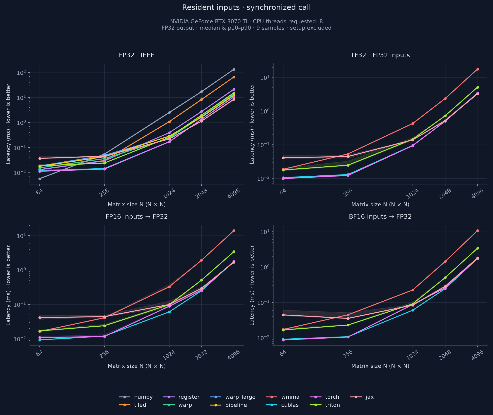
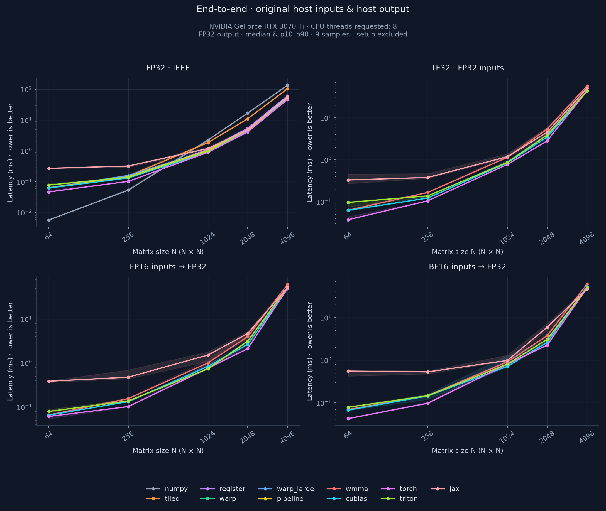
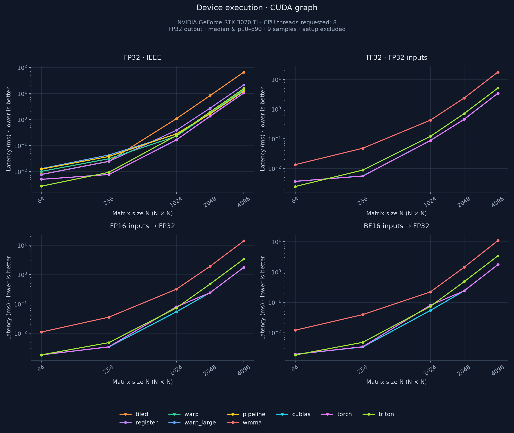
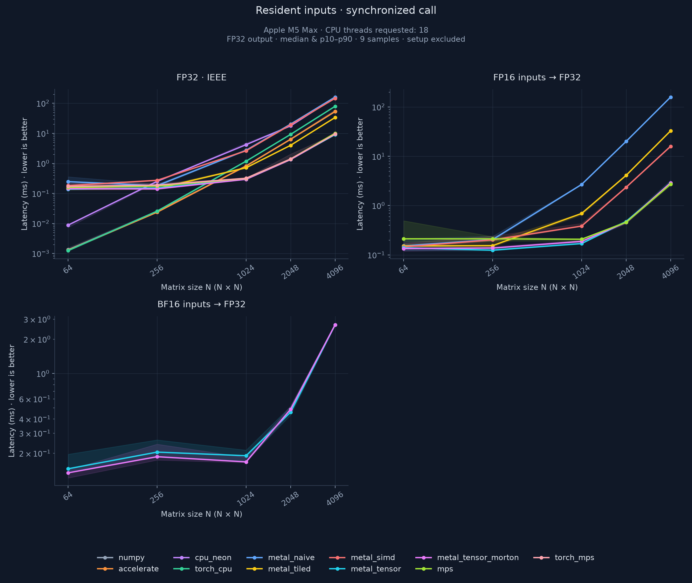
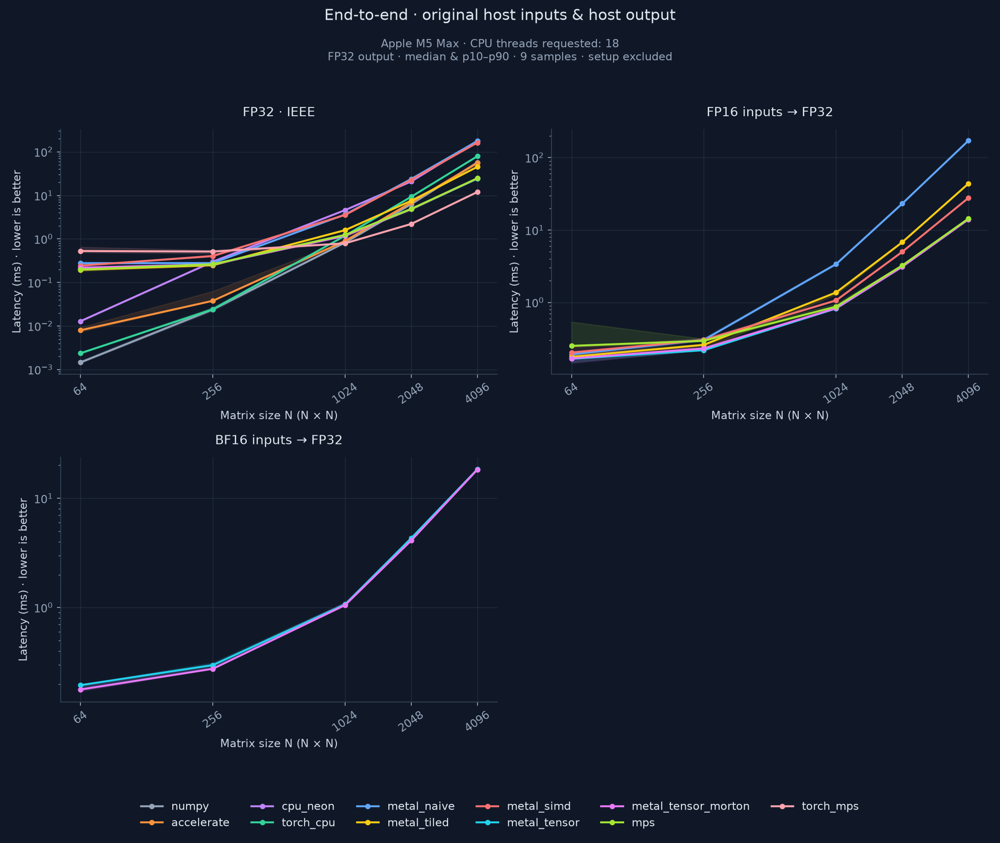
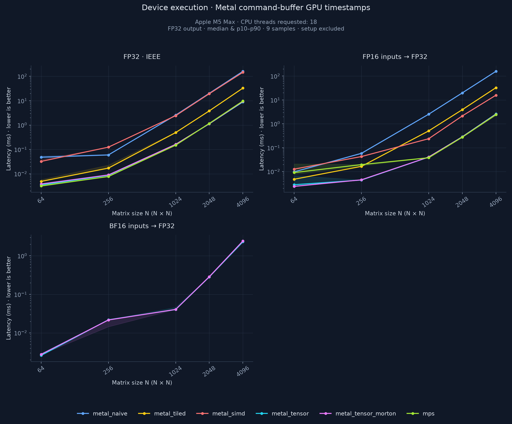
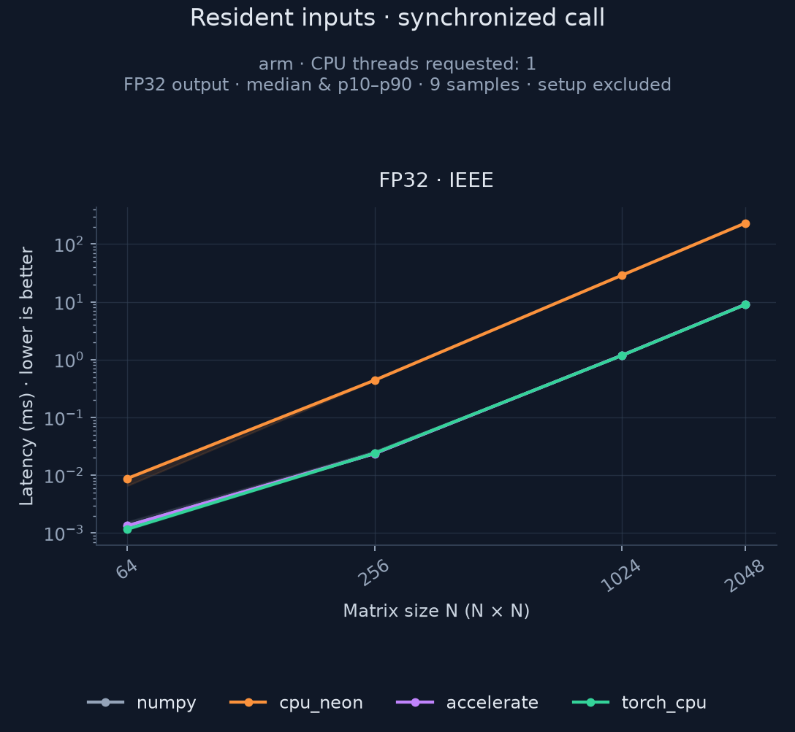

# Matrix multiplication benchmarks

Custom CUDA, Metal and ARM NEON GEMM kernels compared with library implementations. Kernels support rectangular matrices and partial tiles. All outputs and accumulators are FP32.

## Implementations

| Backend | Implementation | Input formats |
| --- | --- | --- |
| `tiled` | CUDA shared-memory tiling, 32×64 output tile | FP32 |
| `register` | CUDA 64×64 tile, 4×4 accumulators/thread | FP32 |
| `warp` | CUDA 64×128 tile, 4×8 accumulators/thread, guarded `float4` loads/stores | FP32 |
| `warp_large` | CUDA 128×128 tile, 8×8 accumulators/thread, K tile 32 | FP32 |
| `pipeline` | CUDA 128×128 tile, K tile 16, double-buffered PTX `cp.async` | FP32 |
| `wmma` | CUDA WMMA, 128×128 tile, eight warps/block | TF32, FP16, BF16 |
| `triton` | Autotuned tiles, warps and pipeline stages; grouped tile ordering | FP32, TF32, FP16, BF16 |
| `metal_naive` | One output/thread | FP32, FP16 |
| `metal_tiled` | 32×32 tile, 2×2 accumulators/thread | FP32, FP16 |
| `metal_simd` | SIMD-group matrix operations, 64×64 tile | FP32, FP16 |
| `metal_tensor` | Metal 4 MPP TensorOps, 64×64 tile | FP32, FP16, BF16 |
| `metal_tensor_morton` | TensorOps with blocked 8×8 Morton tile traversal | FP32, FP16, BF16 |
| `cpu_neon` | ARM64 NEON 4×8 microkernel, 128×128×256 blocking, packed B, persistent workers | FP32 |

Metal TensorOps use [matrix primitives inside the shader](https://developer.apple.com/documentation/metal/running-inline-ml-operations-in-a-shader-with-metal-4), not MPSMatrixMultiplication or the Apple Neural Engine.

## Library baselines

| Backends | Device | Input formats |
| --- | --- | --- |
| `numpy`, `accelerate`, `torch_cpu` | CPU | FP32 |
| `cublas`, `torch`, `jax` | CUDA | FP32, TF32, FP16, BF16 |
| `mps` | Metal | FP32, FP16 |
| `torch_mps` | Metal | FP32 |

## Build

Requirements:

- Python 3.11–3.14 and [uv](https://docs.astral.sh/uv/getting-started/installation/).
- CUDA: Linux, NVIDIA driver, CUDA toolkit with `nvcc` and cuBLAS. PyTorch uses CUDA 12.8 wheels on Linux x86_64.
- `pipeline`, `wmma`, Triton, TF32 and CUDA BF16: compute capability 8.0+.
- Metal/NEON: Apple Silicon, macOS 15+, Xcode/Command Line Tools SDK with Metal 4 declarations. TensorOps require macOS 26+.
- Triton: matching Python development headers (`Python.h`), included with uv-managed Python.

```sh
uv sync --frozen --python 3.12

make                    # Metal + CPU on macOS; CUDA on Linux
make metal              # Individual builds
make cpu
make cuda CUDA_HOME=/usr/local/cuda-12.8 CUDA_ARCH=sm_86

# Optional CUDA backends
uv sync --frozen --python 3.12 --extra triton --extra jax
```

Libraries are written to `build/`. Builds use `-O3` without fast-math. Metal shaders compile at runtime; the offline Metal compiler is not required. CUDA defaults to `CUDA_ARCH=native`; cross-compiled binaries need compatible CUDA runtime/cuBLAS libraries on the target host.

## Run

```sh
# CUDA: custom kernels and libraries
uv run --frozen --python 3.12 --extra triton --extra jax src/main.py --platform cuda \
  --backends numpy tiled register warp warp_large pipeline wmma cublas torch triton jax \
  --precisions fp32 tf32 fp16 bf16 --cpu-threads 8 --output result/my-cuda

# Metal: custom kernels, MPS and CPU baselines
uv run --frozen --python 3.12 src/main.py --platform metal \
  --precisions fp32 fp16 bf16 --cpu-threads 18 --output result/my-mac

# CPU
uv run --frozen --python 3.12 src/main.py --platform cpu \
  --backends numpy cpu_neon accelerate torch_cpu --cpu-threads 18 \
  --modes resident end_to_end --output result/my-cpu

# Rectangular matrices: M×K×N
uv run --frozen --python 3.12 src/main.py --platform metal \
  --shapes 31x33x65 511x257x129 513x129x577 --precisions fp32 fp16 bf16
```

Defaults: square sizes 64–4096, FP32 inputs, 10 warmups, 21 samples, one requested CPU thread. `--platform auto` selects Metal on Apple Silicon, otherwise CUDA if available, otherwise CPU. Optional backends require `--extra triton` / `--extra jax` and explicit selection with `--backends`.

Use `--sizes`, `--shapes`, `--warmup`, `--repeats`, `--modes`, `--device`, `--seed`, `--library`, `--no-plot` and `--output` to configure a run. Unsupported combinations are recorded with reasons. Full options: `uv run --frozen --python 3.12 src/main.py --help`.

## Timing

| Field/mode | Measured work |
| --- | --- |
| `backend_initialization_ms` | Reusable context/library initialization |
| `setup_ms` | Input placement/conversion, output allocation, preparation and first completed call, including JIT/autotuning |
| `device` | CUDA Graph events or Metal command-buffer GPU timestamps; ten GEMMs/batch, normalized per GEMM |
| `resident` | Synchronized wall time with resident inputs; includes dispatch |
| `end_to_end` | FP32 host inputs to owned FP32 host output, including allocation, conversion, packing, copies and readback |

- CUDA kernels, PyTorch CUDA, Triton and NumPy reuse resident outputs. JAX allocates its result. CPU backends, JAX and PyTorch MPS have no device-timestamp rows.
- Metal end-to-end calls allocate fresh shared buffers and copy inputs/results. NEON packs B during setup; end-to-end includes packing again. Worker threads persist across plans.
- CPU thread limits are requested before numerical imports; vendor-library worker counts are not verified. NEON records `actual_threads` separately.
- Samples reuse the same seeded inputs. Validation, graph capture and the first graph replay are excluded from steady-state timing. Clocks and desktop activity are not controlled; p10–p90 bands are sample quantiles, not confidence intervals.

Throughput: `2*M*K*N / seconds / 1e12` TFLOP/s. Setup can use warm caches; it is not a cold-compilation measurement.

## Precision and validation

FP16/BF16 inputs are rounded before multiplication. CUDA FP32 disables TF32; cuBLAS uses pedantic FP32 math. Reduced-precision CUDA reductions and Metal relaxed precision are disabled.

Results are checked against independent CPU FP64 products of the original and precision-rounded inputs. Reports separate total, arithmetic and quantization error. Custom WMMA/Triton TF32 uses nearest-even rounding; library TF32 validation also accepts ties-away and IEEE FP32 inputs.

The component-wise arithmetic bound is:

```text
abs(result - reference) <= atol + rtol*abs(reference) + gamma_K*S
S = abs(A_rounded) @ abs(B_rounded)
gamma_K = K*u / (1 - K*u), u = 2^-23, atol = rtol = 5e-4
```

For `K*u >= 1`, the bound uses `(1+u)^K - 1`; TF32 uses an upper envelope over permitted input roundings. The bound can be loose under cancellation. Implementation: [src/precision.py](src/precision.py). Invalid shapes, nonfinite values, overflow and failed numerical checks abort the run.

## Results

| Directory | Measurements |
| --- | --- |
| [RTX 3070 Ti](result/tensorpc/custom/) | 350 rows; sizes 64–4096; FP32, TF32, FP16, BF16 |
| [M5 Max](result/mac-m5-max/kernels/) | 260 rows; sizes 64–4096; FP32, FP16, BF16; 18 requested CPU threads |
| [M5 Max CPU, one worker](result/mac-m5-max/cpu-1/) | 32 rows; sizes 64–2048 |
| [M5 Max rectangular matrices](result/mac-m5-max/tails/) | 156 rows; partial tiles and Morton blocks |

Each directory contains JSON, CSV and plots for the measured modes. JSON schema 3 includes environment, raw samples, errors, selected kernel configurations and native-library hashes. CUDA build/test details: [custom-build.json](result/tensorpc/custom-build.json). [GTX 1660 results](result/homepc/custom/) are retained separately and excluded from this analysis.

The tables use FP32 inputs/output and synchronized wall time, in milliseconds: `resident` reuses prepared inputs; `end_to_end` includes host-input preparation and result readback. Each case has three warmups and nine samples. GPU-only timings are shown separately. Results from different machines are not directly comparable.

### RTX 3070 Ti

4096×4096; eight requested CPU threads. NumPy runs on CPU, `torch` is PyTorch CUDA. PyTorch CPU was not measured in this run.

| Backend | Device | Resident ms | End-to-end ms |
| --- | --- | ---: | ---: |
| `numpy` | CPU | 133.944 | 135.071 |
| `tiled` | CUDA | 66.155 | 104.202 |
| `register` | CUDA | 21.383 | 60.882 |
| `warp` | CUDA | 13.741 | 50.853 |
| `warp_large` | CUDA | 12.335 | 51.391 |
| `pipeline` | CUDA | 12.295 | 49.490 |
| `cublas` | CUDA | 10.659 | 49.450 |
| `torch` | CUDA | 10.597 | 46.493 |
| `triton` | CUDA | 15.362 | 53.458 |
| `jax` | CUDA | 8.546 | 56.617 |

**Resident latency.** NumPy appears in the FP32 panel; GPU backends also have reduced-precision measurements.



**End-to-end latency.** FP32 host arrays to FP32 host result.



<details>
<summary>GPU-only timing by input precision</summary>

NumPy is excluded because it runs on CPU. JAX has no device-timestamp measurements.



</details>

### Apple M5 Max

4096×4096; 40 GPU cores, 48 GB unified memory, 18 requested CPU threads. `torch_cpu` is PyTorch CPU; `torch_mps` is PyTorch on the Metal GPU.

| Backend | Device | Resident ms | End-to-end ms |
| --- | --- | ---: | ---: |
| `numpy` | CPU | 53.140 | 57.432 |
| `accelerate` | CPU | 53.307 | 55.780 |
| `cpu_neon` | CPU | 157.369 | 179.734 |
| `torch_cpu` | CPU | 79.250 | 79.482 |
| `metal_naive` | Metal | 161.247 | 176.915 |
| `metal_tiled` | Metal | 33.648 | 45.426 |
| `metal_simd` | Metal | 146.670 | 163.231 |
| `metal_tensor` | Metal | 9.079 | 24.291 |
| `metal_tensor_morton` | Metal | 9.425 | 24.625 |
| `mps` | Metal | 10.072 | 24.853 |
| `torch_mps` | Metal | 9.406 | 11.989 |

**Resident latency.** The FP32 panel compares NumPy, Accelerate, PyTorch CPU/MPS, NEON and Metal kernels.



**End-to-end latency.** Includes allocation, conversion and copies in each backend's host-to-host path.



<details>
<summary>GPU-only timing by input precision</summary>

CPU backends and PyTorch MPS have no device-timestamp measurements.



</details>

### CPU libraries and NEON on M5 Max

2048×2048, FP32, resident wall time. The columns specify requested thread limits, not verified vendor-library worker counts. NEON uses one and 16 workers respectively, limited by the 128-row blocks.

| Backend | 1 requested thread, ms | 18 requested threads, ms |
| --- | ---: | ---: |
| `numpy` | 9.019 | 6.357 |
| `accelerate` | 9.076 | 6.326 |
| `torch_cpu` | 9.009 | 9.218 |
| `cpu_neon` | 231.469 | 17.734 |

**CPU size sweep with one requested thread.** Overlapping NumPy, Accelerate and PyTorch curves are separate measurements.



## Tests

Build the native libraries for the target machine, then run:

```sh
uv run --frozen --python 3.12 python -m unittest discover -s tests -v
```

Hardware-dependent tests skip when prerequisites are unavailable.
