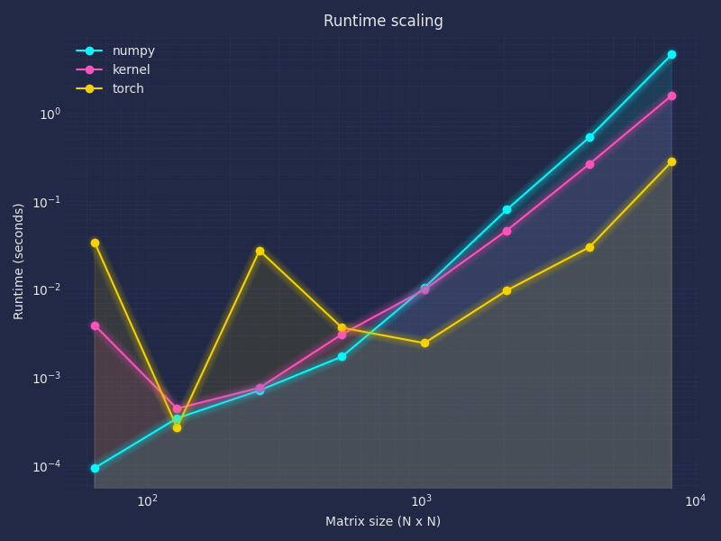

# Make sure you installed uv
### linux/wsl2
```
curl -LsSf https://astral.sh/uv/install.sh | sh
```
### windows
```
powershell -ExecutionPolicy ByPass -c "irm https://astral.sh/uv/install.ps1 | iex"
```

# Compile cuda file
```
nvcc src/matmul.cu -shared -Xcompiler -fPIC -O3 --use_fast_math -o matmul.so
```

# Activate .venv and install python packages
```
uv sync
```

# Run main.py
```
python src/main.py
```

# Result example
